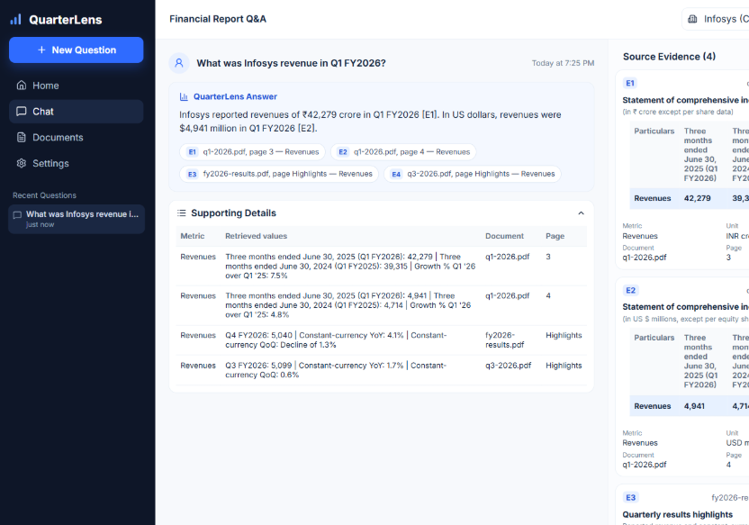

# QuarterLens

QuarterLens is a question-answering app for Infosys FY2026 financial reports. A person asks a question in ordinary language, such as what revenue or operating margin was in a given quarter. The app finds the relevant lines in the indexed results and returns an answer with the document, page, and figures it used.

The goal is a grounded answer. The language model does not invent numbers from memory. It only writes from excerpts the search step retrieved.



## What the user sees

The interface is a chat. The sidebar holds the conversation list. The main panel shows the answer, a small table of the retrieved figures, and source cards for each excerpt. The corpus is Infosys. Official report PDFs are linked from the Documents page.

## How it works

Each report figure is stored as a small chunk with its metric, period, unit, document, and page.

1. **Keyword search** (BM25) finds chunks that share the words in the question.
2. **Vector search** embeds the question with `all-MiniLM-L6-v2` and finds chunks with a similar meaning in a Chroma index.
3. **Fusion and reranking** combine those two lists, then a cross-encoder (`ms-marco-MiniLM-L-6-v2`) reorders the shortlist by how well each chunk answers the question.
4. **Answer generation** sends only the top excerpts to Azure OpenAI (`gpt-5-mini`). The prompt tells the model to use that evidence, avoid guessing, and cite the supplied sources.

The model is not fine-tuned on these reports. Report-specific facts come from retrieval at question time.

## Technologies

| Technology | Role |
|---|---|
| Next.js | Web interface |
| Python | Search and answer service |
| BM25 | Keyword retrieval |
| Sentence Transformers | Embeddings for semantic search |
| Chroma | Vector store |
| Cross-encoder | Reranking retrieved excerpts |
| Azure OpenAI | Writes the final answer from the excerpts |

## Scope

The index covers Infosys results for the year ended March 31, 2026, including the quarterly statements. Source reports:

- [Q1 FY2026](https://www.infosys.com/investors/reports-filings/quarterly-results/2025-2026/q1/documents/q1-2026.pdf), quarter ended June 30, 2025
- [Q2 FY2026](https://www.infosys.com/investors/reports-filings/quarterly-results/2025-2026/q2/documents/q2-2026.pdf), quarter ended September 30, 2025
- [Q3 FY2026](https://www.infosys.com/investors/reports-filings/quarterly-results/2025-2026/q3/documents/q3-2026.pdf), quarter ended December 31, 2025
- [Additional information 2025-26](https://www.infosys.com/investors/reports-filings/documents/additional-information-2025-26.pdf), year ended March 31, 2026

If a figure is not in the index, the app says so instead of filling the gap. QuarterLens summarizes reported figures. It is not investment advice and it does not replace the original filings.

## Run locally

Requires Node.js, Python 3.11, and an Azure OpenAI deployment. From the repository root:

```powershell
npm install
python -m venv .venv
.\.venv\Scripts\python -m pip install -r .\financial-retrieval\requirements.txt
npm run index
```

Put the Azure settings in a `.env` file in the repository root. That file is not committed.

```text
AZURE_OPENAI_API_KEY=your-key
AZURE_OPENAI_ENDPOINT=https://your-resource.cognitiveservices.azure.com/
OPENAI_API_VERSION=2024-12-01-preview
AZURE_OPENAI_MODEL_NAME=gpt-5-mini
LLM_PROVIDER=azure
```

Start the search service, then the site, in two terminals:

```powershell
npm run pipeline
npm run dev
```

Open http://localhost:3000. The vector index and model files are created locally and are not part of the Git repository. A host that only runs the Next.js app cannot answer questions, because search and the language model run in the Python service.
